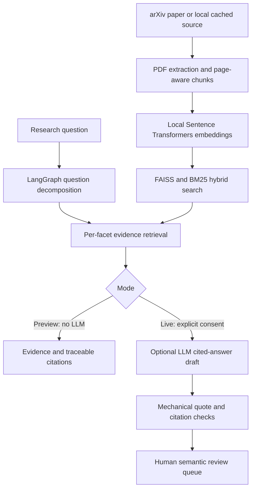

# PaperTrail — Evidence-First AI Research Agent

**PaperTrail** is a Python research assistant for **arXiv scientific papers**. It breaks down research questions, retrieves source passages with page references and helps users inspect evidence. An **optional** OpenAI-compatible LLM can generate a cited answer draft, while strict quote/source checks and a local human-review workflow help identify unsupported claims.

> **v1.6.2 · Phase 6 GitHub release candidate.** This is an experimental research assistant—not an autonomous scientific fact checker. Literal citation matching does **not** establish semantic entailment, true original-PDF provenance or factual accuracy. Results from one provisionally annotated paper and synthetic regressions are **not** independently labeled research accuracy scores.

## Workflow



## Features

- **Scientific paper intake:** bounded public arXiv search/import with a separately approved network action, plus local PDF text extraction and source hashing.
- **Local RAG:** page-aware text chunks, Sentence Transformers embeddings, FAISS vector search, BM25 lexical search and hybrid reciprocal-rank fusion.
- **Research Agent:** LangGraph decomposes multifaceted questions, executes constrained tools, assesses evidence and retries within bounded limits.
- **Offline Preview (default):** shows retrieved evidence, source pages and diagnostics **without calling an LLM or generating a final answer**; it requires previously cached paper/index/model artifacts.
- **Optional Live:** an explicitly requested, potentially paid OpenAI-compatible LLM synthesis call with bounded citations and quote anchoring; never enabled automatically by the presence of a key.
- **Faithfulness guard:** detects mechanically invalid claims/citations; the human-review workflow records semantic judgments without pretending to verify them automatically.
- **Streamlit UI:** Research, Paper library, Human review and diagnostics; separate CLI and Python test suites.
- **Experimental retrieval:** optional `focused`, `multi` and `budgeted` policies exist for **Preview only**; production/default remains `baseline`.

## Quick start — Windows PowerShell

Requires Python **3.11+**. Work from the inner `papertrail-research-agent` folder:

```powershell
py -3 -m venv .venv
.\.venv\Scripts\python.exe -m pip install -e ".[dev,embeddings,search,agent,ui]"
.\.venv\Scripts\python.exe -m pytest -q
.\.venv\Scripts\python.exe tools\check_release.py
.\.venv\Scripts\python.exe -m papertrail doctor
.\.venv\Scripts\python.exe -m streamlit run streamlit_app.py --server.address 127.0.0.1 --server.port 8501 --browser.gatherUsageStats false
```

Open **http://127.0.0.1:8501**. The UI is **single-user / localhost-only** and has no authentication; do not expose it to the public internet.

Downloaded papers, local embeddings, vector indexes, model weights, API credentials and reviewer notes are intentionally **not included in the repository ZIP**. To test Preview using existing research data, copy the earlier PaperTrail `data/` folder into this project (see [Release Guide](docs/GITHUB_RELEASE.md)). Alternatively use **Paper library** to import a public paper with explicit permission; first-time model-weight downloads require internet access.

**Example question**, when paper `2510.22344` has been indexed:

> Compare FAIR-RAG with traditional RAG and discuss their evaluation metrics and limitations.

Choose **Preview**, **Baseline**, and `top-k=3`. Click **Run PaperTrail** to see the workflow progress bar (percentage and completed stage), then inspect the Retrieved evidence and Execution diagnostics tabs. The bar reports **completed workflow milestones**, not elapsed time or model-weight loading progress; a long embedding step may keep the same percentage until it finishes. **Preview deliberately does not produce an LLM-written answer.**

## CLI modes and API behavior

**Preview — no model-provider API key required:**

```powershell
.\.venv\Scripts\python.exe -m papertrail agent-answer --paper-id 2510.22344 --question "What does FAIR-RAG change compared with traditional RAG?" --mode preview
```

**Live — optional model generation:** Copy `.env.example` to `.env`, add your own `OPENAI_API_KEY` locally (never commit it), then explicitly select `--mode live`:

```powershell
Copy-Item .env.example .env
# Edit your local .env to add OPENAI_API_KEY (do not paste it in chat or Git).
.\.venv\Scripts\python.exe -m papertrail agent-answer --paper-id 2510.22344 --question "What does FAIR-RAG change compared with traditional RAG?" --mode live
```

Live may incur provider charges and sends the question and bounded passages to the configured OpenAI-compatible provider. In the **Streamlit UI**, Live also requires an explicit approval checkbox and clicking Run. Public arXiv API/network use is a separate opt-in and does **not** require the answer-model API key.

## What citation validation means

A claim may be rejected if its source ID, page, registered quote or numeric grounding is invalid. A claim with a matching quote is **quote-anchored**, but not proven factually or logically supported by that quote. The human-review queue allows `supported`, `unsupported` or `insufficient_context` decisions after reading the original PDF. No fully automated semantic entailment verifier is implemented.

An exploratory FAIR-RAG benchmark uses **four selected, unverified log-derived chunk anchors from one paper**. In an earlier run, Budget-Aware Fusion at `top-k=5` retained 4/4 anchors after fusion, but only 3/4 reached the model-visible source register. These numbers are **not** independently judged Recall@K, generalization evidence or answer faithfulness scores. Baseline was not replaced based on this result.

## Repository map

| Path | What it contains |
|---|---|
| `src/papertrail/discovery/` | Public arXiv metadata discovery |
| `src/papertrail/ingestion/` and `chunking/` | PDF/page provenance and chunks |
| `src/papertrail/embedding/` and `retrieval/` | Local embeddings, FAISS, BM25, fusion |
| `src/papertrail/agent/` | LangGraph workflow, tools and faithfulness checks |
| `src/papertrail/ui/` and `streamlit_app.py` | Streamlit UI over the real Agent pipeline |
| `benchmarks/` and `tests/` | Provisional diagnostics and offline regression tests |
| `tools/check_release.py` | Offline release structure and secret-pattern checks |
| `docs/` and `.github/workflows/` | Architecture, release guide and CI |

## Boundaries and reproducibility

- No OCR, robust formula/table extraction, cross-paper synthesis, independent multi-paper relevance labels, automated semantic claim verification, or authenticated public hosting.
- Dependencies specify compatibility ranges rather than a complete lockfile; hardware, first model downloads and provider costs vary.
- Source PDFs and extracted articles may be copyrighted and must not be uploaded with this project. Code is under MIT; third-party articles and model weights have their own licenses.
- The release scanner checks known secret patterns (including notebook **cells and outputs**) and ignores local runtime directories. It is a **heuristic**, not a full security audit or Git history scan.
- Passing synthetic tests is not proof of scientific answer quality. Independently judged multi-paper evaluation, manual PDF provenance review and a real approved Live check remain future validation work.

**Guides:** [Publish on GitHub](docs/GITHUB_RELEASE.md) · [UI / Windows setup](docs/PHASE5_STREAMLIT_UI.md) · [Quality gates](docs/QUALITY_GATES.md) · [Security](SECURITY.md) · [Contributing](CONTRIBUTING.md) · [Changelog](CHANGELOG.md)
