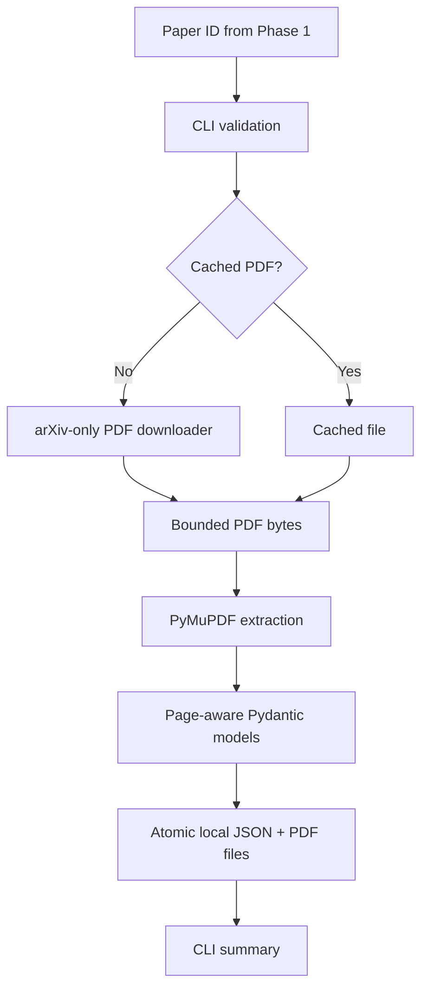
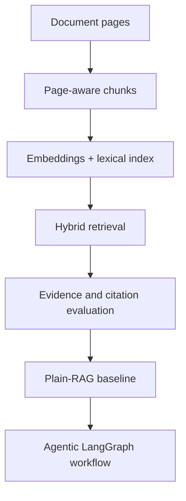
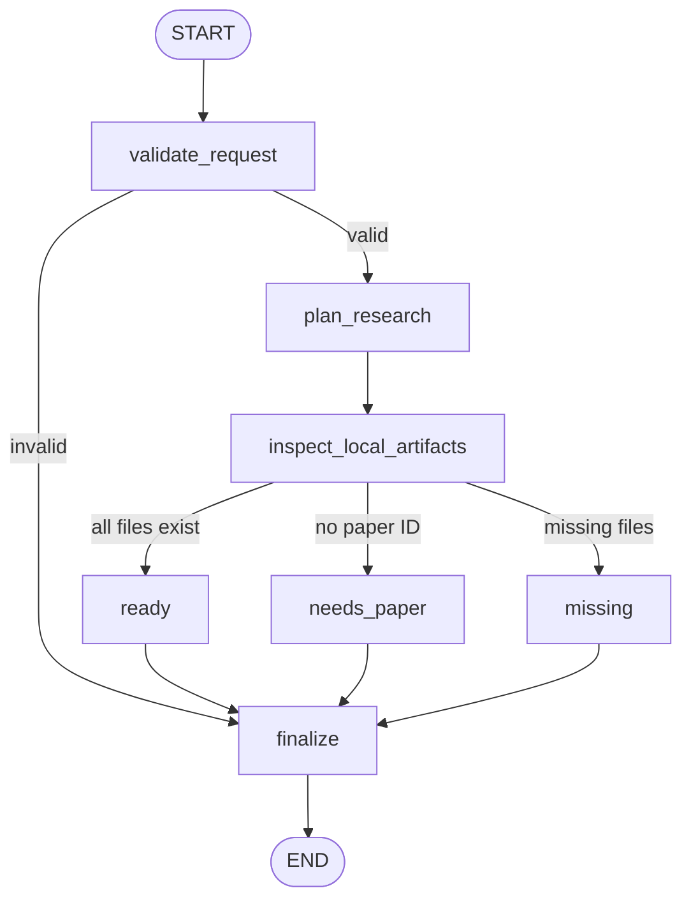

# Architecture decisions — Phases 2.1–3.2

## Goal

Build independently testable *ingestion* components before indexing and agent orchestration. We require auditable PDF provenance: arXiv identifier, source URL, SHA-256 digest, and **1-based page numbers**.

## Modules

- **`discovery/`**: Phase 1 public metadata search. Unchanged.
- **`ingestion/pdf_downloader.py`**: transport, input validation, redirect restrictions, download budgets.
- **`ingestion/pdf_extractor.py`**: decoding and ordered per-page text extraction, content hashing.
- **`ingestion/pipeline.py`**: cache and storage decisions; files remain under Git-ignored `data/`.
- **`config.py`**: bounded settings for downloads and extraction.
- **`cli.py`**: human-controlled commands; no LLM or autonomous tool usage yet.

## Pipeline vision (the retrieval portion is implemented)

## Key tradeoffs

1. **Page extraction over whole-document blobs:** citations can later point to exact pages.
2. **Download/extraction separation:** transport and document parsing are testable independently.
3. **Bounded PDF size/pages:** limits mitigate accidents, not a complete sandbox for hostile PDFs.
4. **No OCR yet:** transparent failure is safer than silently inventing text for scanned pages.
5. **No vector database yet:** validate document extraction first; avoid adding untested complexity.
6. **No arbitrary HTTP URLs:** paper IDs determine arXiv-only endpoints, reducing SSRF risk.
7. **Conservative license handling:** cached e-prints and extracted text are not packaged for public release.

## Phase 2.2 addition

`chunking/chunker.py` is deliberately a pure offline transformation of
`ExtractedDocument` into `ChunkedDocument`. The output carries page and
character offsets along with the source PDF SHA-256 so future retrieval can
trace each candidate passage to its source page. The file adapter
`chunking/pipeline.py` reads a local `data/extracted/<id>.json` and writes
`data/chunks/<id>.json`; `storage.py` supports atomic writes for both phases.
The chunker is not a retriever, and no embedding model or LLM is involved.

## Phase 2.3 addition

The local embedding step reads the **unchanged** Phase 2.2 chunk JSON. `embedding/encoder.py` adapts a pinned MiniLM revision and counts the true model input tokens without truncation; `embedding/pipeline.py` performs batch encoding only after the preflight passes. It writes L2-normalized `float32` vectors to `data/embeddings/<id>.npy` and an integrity manifest to `data/embeddings/<id>.manifest.json`. Each vector row is tied to an ordered chunk ID (including page/offset provenance), and both source JSON and matrix are SHA-256-checked before reuse. Unit tests use a fake encoder so CI needs no HF model download. The search index is implemented starting in Phase 2.4.

## Phase 2.4 additions

- `embedding/pipeline.py:load_saved_embedding_bundle`: verified read-only contract between chunk sources, embedding matrix and manifests; fails closed on stale inputs.
- `retrieval/faiss_store.py`: exact, deterministic FAISS `IndexFlatIP` and cached index with SHA-256 provenance. For hundreds of vectors, exhaustive cosine search is a transparent baseline.
- `retrieval/search.py`: verifies the query encoder matches saved document embeddings, normalizes the query, and joins returned rows back to citation metadata.
- Indexes are one-per-paper and contain vectors only. Untrusted PDF text remains **data**, not executable instructions.
- Phase 2.5 adds lexical BM25 and RRF; answer synthesis remains future work.

## Phase 2.4.1 reading-order quality patch

The PDF ingestion step now uses `ingestion/layout.py` for conservative two-column reading-order reconstruction while preserving page-level provenance. Pages without confident two-column detection use the prior simple extraction strategy. See `PHASE2_4_1_LAYOUT_QUALITY.md` for limitations.

## Phase 2.5 addition

- `retrieval/bm25.py`: in-memory Unicode lexical search on the same chunks used by FAISS; no new external search service or persistent lexical cache.
- `retrieval/hybrid.py`: candidate union and reciprocal rank fusion (`k=60`), exposing both input rankings/scores and individually cited adjacent chunks.
- `retrieval/evaluation.py`: a **narrow, user-verified four-dataset name coverage diagnostic** against the same question for dense and hybrid retrieval. It is not an unbiased end-to-end evaluation suite.
- Cached model revision, index digest and source PDF identifiers are checked by the pre-existing bundle/index loaders. All citation texts come directly from verified chunk files, never fabricated.
- Real document layout completeness still needs a manual audit; RRF cannot solve extraction corruption.

## Phase 2.6: retrieval evaluation

A versioned provisional suite (`benchmarks/fair_rag_pages_v1.json`) describes a paper ID,
8 natural-language questions and coarse page-level judgments. The evaluator reads a
validated, hash-bound local chunk/embedding bundle; sends each question to BM25,
FAISS and hybrid RRF; scores only primary chunks at K=1,3,5,10; and writes compact
JSON/Markdown reports to `data/evaluations/`. A single pinned encoder instance is
reused across all queries. Pages are proxy judgments, not evidence-span annotations;
no LLM, answer generation or claim validation occurs at this stage.

## Phase 2.7 — Controlled retrieval tuning

The RRF fusion module now accepts explicit dense and BM25 ranking weights and an **optional** post-ranking per-page cap (off by default). The optimizer loads the **verified frozen** chunk/embedding bundle and provisional page-relevance suite, collects FAISS + BM25 results only once per question, then scores a fixed candidate grid with a deterministic six/two query split. The selected configuration is based on training judgments only; validation merely diagnoses the selection. It emits review candidates and a `not_deployed` report; it does not modify the runtime defaults or labels. See [Phase 2.7 guide](PHASE2_7_RETRIEVAL_OPTIMIZATION.md).

## Phase 3.1 — First real LangGraph StateGraph (offline only)

- `agent/workflow.py`: TypedDict shared state and `trace` reducer (`Annotated[list, operator.add]`), small independently tested nodes, and a lazily compiled `StateGraph`.
- Every graph run is independent and bounded by `recursion_limit=16`. There is no persistent checkpoint yet.
- The node names and event trace record **which local nodes actually executed**; the `plan` is a declared checklist, **not** an executed research plan.
- Inspecting local artifacts checks **file existence only**. It does not deserialize a FAISS index or assert SHA/provenance correctness; that requires the established retrieval pipeline's guarded loaders in a future phase.
- Input `paper_id` is validated against arXiv ID syntax before using any filesystem paths.
- No LLM, arXiv network access, retrieval, evidence sufficiency judgment, or synthesis is part of this release.
- LangGraph is an opt-in dependency `[agent]`; the rest of the CLI works without it. CI installs it and runs native graph tests.

See [LangGraph Foundation Guide](PHASE3_1_LANGGRAPH_FOUNDATION.md).

## Phase 3.2 — research planning subgraph (v1.1.0)

The StateGraph topology remains: validate → plan_research → inspect_local_artifacts → status branch → finalize. Planning now uses `planning.py` to derive topic-specific subquestions, constructs an ordered `ResearchPlan` with explicit `depends_on` edges and validates it with a Pydantic DAG model. Each retrieval subquestion maps to an **unexecuted** `hybrid_retrieval` task. The `planner` state records whether an opt-in model successfully proposed subquestions or the deterministic offline fallback was used; model proposals have no evidentiary authority. Optional provider I/O (`llm_planner.py`) has no direct authority to call research tools or alter graph topology. `planning_eval.py` is an offline synthetic regression harness. See [PHASE3_2_RESEARCH_PLANNING.md](PHASE3_2_RESEARCH_PLANNING.md) for security and output contracts.

## Phase 3.3 — Real tool nodes (v1.2.0)

The new `agent/tool_execution.py` compiles a **separate** `StateGraph` for real tool execution. Existing `agent-preview` remains backward compatible: it still executes planning only. `agent-research` adds `select_source` (offline vs opt-in metadata discovery), `discover`, `prepare` (offline cached ingestion, chunk/embed/index on demand), a bounded `retrieve` loop, and `finalize`. Each expensive tool call consumes budget; validation errors and upstream failures are sanitized.

`PaperTrailTools` is a small real-adapter boundary calling the pre-existing arXiv, PDF, chunk, embedding, FAISS and hybrid retrieval modules. The adapter can be injected with test fakes; production uses the real modules. With cached artifacts and an explicit arXiv ID, no discovery/download/LLM call is needed; the index is checked, then each research subquestion invokes hybrid retrieval.

A hash-checked source chain (when PDF + extracted JSON are available) and vetted chunk/embedding/index contracts reduce accidental corpus mismatches. They do not validate source article claims, OCR, tables, or the provisional relevance annotations. The `assess` and `answer` tasks are deliberately *not executed* until Phase 3.4/3.5. See `docs/PHASE3_3_REAL_TOOL_INTEGRATION.md`.

## Phase 3.4 — Evidence assessment (not synthesis)

The `agent-assess` CLI uses the Phase 3.3 tool graph with an additional `assess_evidence` node and bounded conditional `retry_evidence` node. The pure `agent/assessment.py` module evaluates distinct primary chunk coverage **separately per planned research facet** and reports source-page diversity and repeated evidence. It marks semantic/factual verification as unperformed. Under-covered facets can trigger **one** query simplification (user's original question only) per facet; `max_tool_calls` and `--max-refinement-rounds` enforce hard boundaries. The `answer` DAG step never executes; no generated claims or API key are needed in the default path. Source extraction/table provenance and preliminary qrels remain unreviewed.

## Phase 3.5 — Quote-anchored answer synthesis (opt-in)

`agent-answer` reuses `build_tool_graph` with `synthesize_mode=True`. Source selection, cache integrity checks, bounded hybrid retrieval, structural evidence assessment and single-query refinement run unchanged. The new `synthesize_answer` node is conditional: it will *not* call a model when any retrieval facet remains below the structural threshold. Preview builds a bounded register of source IDs (`E01` etc.) with verified arXiv page links and performs no generation.

In live mode, the `OpenAICompatibleAnswerGenerator` sends a bounded untrusted evidence payload to a configured OpenAI-compatible `/chat/completions` endpoint. The model proposes strict JSON `claims`, each with one or two registered same-facet source IDs and verbatim 20+ character supporting text. `validate_and_render_draft` rejects forged citations, absent excerpts, unquoted numeric facts, malformed output and untrusted Markdown/URLs; **the application** supplies the approved page citation. No raw provider error body is logged. Model invocations are **explicit opt-in**, may cost money, and are limited to one generation call per run (two total if user additionally opts into an LLM planner).

**Critical limitation:** quote presence is not logical entailment. Neither a real quote nor a retrieval score proves the claim true, complete, fair or non-contradictory. Source PDF reading-order quality, reference labels and tabular values still need human audit. Any generated answer is marked `unverified`; independent end-to-end QA evaluation and semantic faithfulness remain release blockers. See [`PHASE3_5_CITED_ANSWER_GENERATION.md`](PHASE3_5_CITED_ANSWER_GENERATION.md).

### Phase 3.5.1: safe diagnostic boundary

The live answer provider remains opt-in and bounded to a single synchronous generation request.
After strict citation validation, a mixed draft may yield a **partial, human-review-required** output consisting only of independently validated claims. A draft with no validated claims remains rejected; fixed-code diagnostics identify the first bad source-quote/facet/number constraint without logging the raw model content or secrets.

## Phase 4.1: offline diagnostic evaluation layer

A dedicated `papertrail.agent.evaluation` module executes `run_agent_research(..., synthesize_mode=True, synthesis_provider=None)` once per configured k under `allow_network=False` and the deterministic planner. It reads primary `evidence[].hits` and `synthesis.source_register` to identify provenance-labeled reference anchors lost **before** versus **during** source selection. It never runs an LLM and it never grades generated claims for entailment. An optional separately-supplied, bounded historical Live summary is displayed as *reported*, not revalidated. Results are saved as JSON/Markdown to `data/agent_evaluations/`. Bundled benchmarks contain provisional exact IDs from local user logs; development-facing diagnostics only.

## Phase 4.2.2: experimental budget-aware query fusion

The `budgeted` execution style runs the same two locally validated baseline/focused hybrid searches per facet as `multi` (RRF). Instead of ranking by the sum of reciprocal source ranks, it interleaves distinct focused/baseline hits, starting focused, and stops at the identical per-facet `top-k` budget. This heuristic increases representation of both branches, without verifying relevance. The baseline production/default behavior is untouched and all experimental modes remain offline, deterministic and Preview only.

`agent-budget-evaluate` executes baseline, focused, multi and budgeted on the same locally cached paper and top-k values; compares real selected chunks (never the theoretical unbounded union as though it were the result); records retrieval call counts and loss points. Safety boundary: four log-derived FAIR-RAG anchors have not been independently adjudicated, PDF-layout correctness is not verified, and answer semantic entailment is NOT implemented. See [`PHASE4_2_2_BUDGET_AWARE_FUSION.md`](PHASE4_2_2_BUDGET_AWARE_FUSION.md).

## Phase 5 user interface

`streamlit_app.py` → `papertrail.ui.service` → existing `papertrail.agent.tool_execution.run_agent_research` → LangGraph retrieval / synthesis / faithfulness audit. The view is **not a second Agent** and does not replace core quality gates. Live requires an explicit paid-capable model confirmation; imports require separate explicit network permission. Local review queues use Phase 4.3's save/summary schema and user-entered decisions are not ground truth. See [PHASE5_STREAMLIT_UI.md](PHASE5_STREAMLIT_UI.md).
