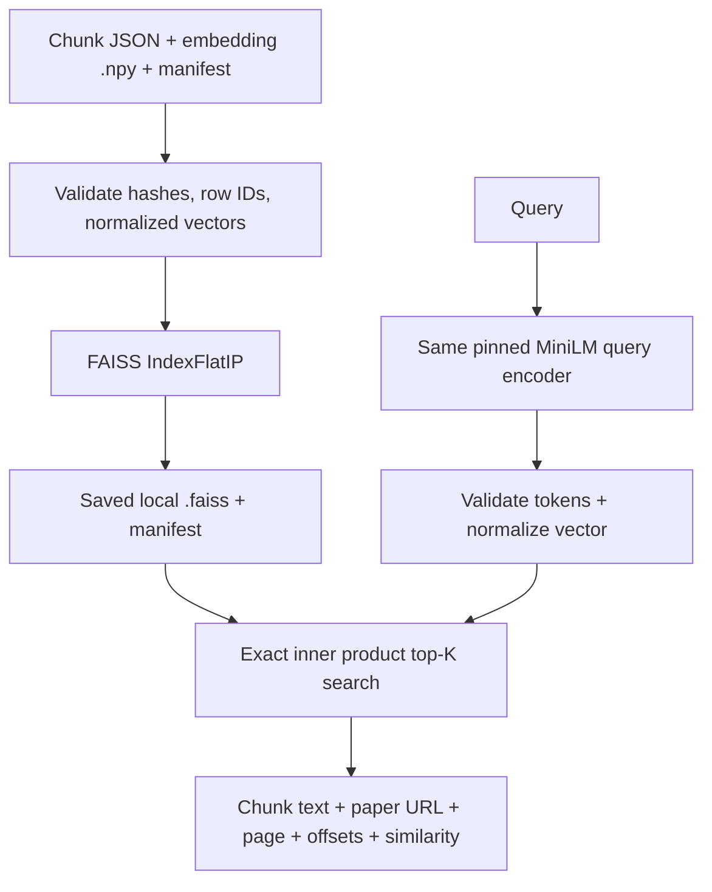

# Phase 2.4 — Exact local FAISS vector retrieval

## Why this phase exists

Embedding creation converts each paper's source-attributed chunks into 384-dimensional vectors. Phase 2.4 indexes those **already generated** vectors, encodes a *user query* with the same pinned model, ranks similar vectors, and returns **verbatim** source chunks with 1-based PDF page numbers.

This is an **evidence retriever**, not an LLM answer generator, research report, or agent.

## Architecture



With L2-normalized document and query vectors, **inner product equals cosine similarity**. `IndexFlatIP` is exact rather than approximate; it is intentionally straightforward for a corpus of only hundreds of vectors. FAISS scores are **similarity scores, not calibrated probabilities**. A score of `0.78` does **not** mean a 78% chance that the chunk is factual or useful.

This version builds **one index for each arXiv paper**. Multi-paper search, hybrid retrieval, reranking and recall evaluation are later phases.

## Windows PowerShell — fresh full ZIP

Open `papertrail-research-agent` in VS Code:

```powershell
py -3 -m venv .venv
.\.venv\Scripts\python.exe -m pip install -e ".[dev,embeddings,search]"
.\.venv\Scripts\python.exe -m papertrail doctor
.\.venv\Scripts\python.exe -m pytest -v
```

If you extracted a **new** full-project ZIP, its `data/` directory is absent. Recreate the sample input (or copy the complete `data/` directory from your previous v0.5.0 project):

```powershell
.\.venv\Scripts\python.exe -m papertrail ingest-pdf --paper-id 2510.22344
.\.venv\Scripts\python.exe -m papertrail chunk-document --paper-id 2510.22344 --chunk-size 650 --overlap 100
.\.venv\Scripts\python.exe -m papertrail embed-document --paper-id 2510.22344 --batch-size 16
```

Build the FAISS index and run two real queries:

```powershell
.\.venv\Scripts\python.exe -m papertrail index-document --paper-id 2510.22344
.\.venv\Scripts\python.exe -m papertrail search-chunks --paper-id 2510.22344 --query "What is Structured Evidence Assessment?" --top-k 3
.\.venv\Scripts\python.exe -m papertrail search-chunks --paper-id 2510.22344 --query "Which benchmarks evaluate FAIR-RAG?" --top-k 3
```

`index-document` creates:

```text
data/
  indexes/
    2510.22344.faiss
    2510.22344.manifest.json
```

Second `index-document` call will report `status: cached` when artifacts still match. `index-document --force` intentionally rebuilds. `search-chunks` automatically builds a missing index; it cannot generate missing document embeddings. The model is loaded lazily, so indexing alone does not load the model or call the network.

## Inspecting output

A search result includes:

- `rank`: position among search results (1 = highest score)
- `score`: cosine similarity, **not a confidence estimate**
- `chunk_id`: exact ID corresponding to the vector row
- `text`: excerpt from the extracted PDF, not generated text
- `paper_id`, `source_url`, `page_number`: article provenance; page numbers start at **1**
- `start_char`, `end_char`: original page character span, exclusive end
- `citation`: arXiv article URL with `#page=N` hint (PDF viewer behavior depends on the viewer)
- `index_cached`: whether the FAISS index file was reused

**Manual quality gate:** Search for (a) SEA, (b) benchmarks used in evaluation and (c) adaptive query refinement. Inspect whether the top 3 excerpts actually contain relevant passages. Save results and any false positives/poor rankings for evaluation. No quality metric is claimed until human relevance judgments exist.

## Integrity and limits

- The stored `.npy` and its manifest MUST agree with the chunk JSON. A mismatch stops retrieval; regenerate embeddings.
- Index manifest contains SHA-256 values of its source vector and chunk files; a stale/corrupted index cache is rebuilt.
- Native FAISS serialization/deserialization **is not safe for arbitrary untrusted files**. Only work with artifacts generated inside your own `data/` directory. Checksums detect accidental corruption, *not* a malicious actor who can edit both file and manifest.
- The pinned model revision for queries must match the document embeddings. Changing the model requires re-embedding.
- Retrieval has bounded queries (`<=2000` characters) and `top_k` (`1..20`), token preflight, shape and finite checks.
- Tests use an injectable NumPy-based test double, so algorithmic checks run offline. A separate native FAISS smoke test runs when `faiss-cpu` is installed. The **real Windows run** remains the definitive end-to-end integration check.
- Dense retrieval can miss lexical constraints, negation and exact numbers; Phase 2.5 introduces BM25 and hybrid ranking.
- This is **single-paper** only. It does not answer questions with an LLM and does not prove retrieved evidence supports an answer.

## Code map

| File | Responsibility |
|---|---|
| `embedding/pipeline.py` | Verified saved embedding bundle loader |
| `embedding/encoder.py` | `encode_query` using the document model revision |
| `retrieval/faiss_store.py` | Index building, caching, checksum validation and load |
| `retrieval/search.py` | Query validation, encoding, ranking, grounded results |
| `tests/test_vector_search.py` | Deterministic offline ranking, corruption, caching and citation tests |
| `tests/test_faiss_native_optional.py` | Actual FAISS serialized-index smoke test when installed |

## Future phase

Phase 2.5 combines dense retrieval with lexical BM25 retrieval using a reproducible fusion method, with a comparison set to quantify the gain over the single-model baseline.
