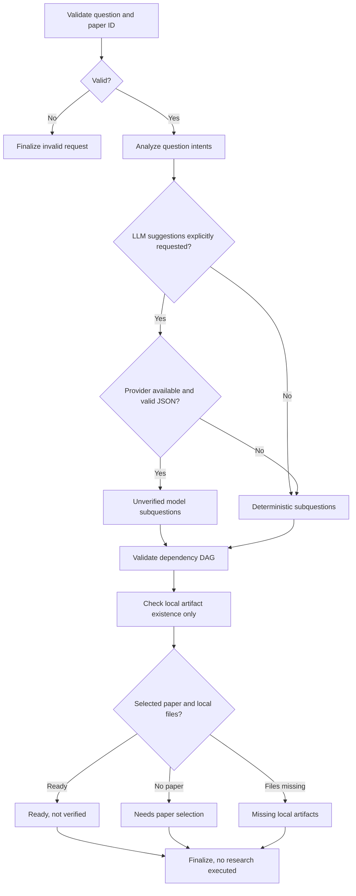

# Phase 3.2 — Question-Aware Research Planning (v1.1.0)

## What is actually implemented?

This phase upgrades the **real LangGraph scaffold** from a constant six-step outline to a **structured, question-dependent dependency DAG**. It runs the question-validation, planning, source-artifact preflight, routing and finalization nodes. **The planned discovery, ingestion, indexing, retrieval, evidence review and answer synthesis steps do not execute.** This distinction remains explicit in every task's `execution: not_executed` field.

| New component | Responsibility |
|---|---|
| `agent/planning.py` | Normalize/inspect research questions, detect multiple research facets, propose bounded subquestions and construct/validate a dependency DAG |
| `agent/llm_planner.py` | Opt-in OpenAI-compatible suggestion client, bounded request, strict JSON, deterministic fallback on failure |
| `agent/planning_eval.py` | Offline, synthetic fixture regression and JSON/Markdown reports |
| `agent/workflow.py` | Put a question-specific plan and analysis in the LangGraph state; report truthful trace and call counters |
| `benchmarks/planning_cases_v1.json` | 12 hand-authored **synthetic** classification cases for regression checks, *not* external quality labels |

## Research planning flow



A plan always keeps tasks in dependency order. For a selected article, it starts at ingestion. With no selected paper, it also plans discovery. The planner inserts one retrieval task for each proposed facet/subquestion, then evidence assessment dependent on all retrieval tasks, then cited synthesis dependent on assessment.

### Question types

The default **deterministic rule-based** planner detects hints for comparison, datasets, sample sizes, metrics, limitations, methodology, iteration counts, evidence sufficiency and definition. Multiple facets lead to multiple retrieval tasks (maximum five). Unrecognized questions receive one conservative general retrieval task. Some references to “this paper” are marked ambiguous when no paper ID is supplied. Rules are transparent and reproducible; **they are not a full natural-language understanding model**.

### LLM planning (optional; never automatic)

`agent-preview --planner llm` attempts **one** OpenAI-compatible Chat Completions request *only if* `OPENAI_API_KEY` is configured. It asks for a JSON object with `subquestions` (1–5 strings), not an answer, facts, citations or a tool execution plan. On any unavailable/invalid result, the deterministic planner is used. The trace and `planner` fields distinguish both outcomes. Credentials live only in the transient client closure, **not the LangGraph state** or serialized reports. Raw model output, HTTP error bodies, and credentials are not returned.

The application treats model-proposed questions as **untrusted**: length, duplicates, JSON shape, suspicious commands/links and URL shape checks are enforced. This is only a safety and structural filter, **not proof of semantic relevance**. Running the LLM mode sends the research question to the configured external provider. Base URLs must be HTTPS except for explicit localhost testing. Do not enter confidential source material unless you intend to share it with the configured provider.

The provider may hallucinate an irrelevant subquestion. The output is visibly tagged `llm_proposal_unverified`. The downstream paper retrieval and evidence-verification steps have not been implemented yet.

## Installation (Windows PowerShell)

Extract the full ZIP. Open the `papertrail-research-agent` subfolder (the one containing `pyproject.toml`) in VS Code. The previous phase 3.1 `data` folder can be reused:

```powershell
Copy-Item -Path "..\..\papertrail_phase3_1_langgraph_foundation_full\papertrail-research-agent\data" -Destination ".\data" -Recurse -Force
py -3 -m venv .venv
.\.venv\Scripts\python.exe -m pip install -e ".[dev,embeddings,search,agent]"
.\.venv\Scripts\python.exe -m papertrail doctor
.\.venv\Scripts\python.exe -m pytest -q
```

## CLI demonstrations

Focused **offline** planning (no API call):

```powershell
.\.venv\Scripts\python.exe -m papertrail agent-preview --question "Which datasets were used to evaluate FAIR-RAG in the experiments?" --paper-id 2510.22344
```

Multi-faceted comparison, showing multiple evidence tasks:

```powershell
.\.venv\Scripts\python.exe -m papertrail agent-preview --question "Compare FAIR-RAG and traditional RAG, including evaluation metrics and limitations." --paper-id 2510.22344
```

Opt-in LLM mode, which falls back offline when no key is configured:

```powershell
.\.venv\Scripts\python.exe -m papertrail agent-preview --planner llm --question "Compare FAIR-RAG and traditional RAG and explain the limitations." --paper-id 2510.22344
```

Set `OPENAI_API_KEY`, `PAPERTRAIL_MODEL_NAME`, and `PAPERTRAIL_OPENAI_BASE_URL` in your uncommitted project `.env` if you explicitly want to use a provider. **No API key is necessary for recommended offline mode.** Do not paste secrets into screenshots or logs.

Execute synthetic regression suite (no PDF or model required):

```powershell
.\.venv\Scripts\python.exe -m papertrail evaluate-planning --suite benchmarks/planning_cases_v1.json
```

Read UTF-8 report:

```powershell
Get-Content -Encoding UTF8 .\data\evaluations\planning_cases_v1_planning.md
```

## Report and quality contract

`question_analysis` contains `intents`, `complexity`, `requires_comparison`, `subquestions`, `ambiguity_flags`, `analysis_method`. The ordered `plan` contains `id`, `task`, `depends_on`, `expected_output`, `proposed_tool`, `search_query`, `execution`. `plan_validation` is `validated_dependency_dag` if the graph was successfully constructed. `planner` reports selected source, request mode, optional fallback reason and proposal-unverified status. `trace` records nodes actually executed.

An offline run always reports **`tool_calls: 0`, `llm_calls: 0`, `research_executed: false`, `answer_generated: false`**. Opt-in LLM planning can report `llm_calls: 1`, **but still `tool_calls: 0` and no research execution**. Local file checks verify presence, not SHA-256, PDF completeness or citation correctness.

The 12 synthetic regression labels are manually chosen based on simple examples. A high match rate only indicates the rules fit these examples and do not regress on them. It does **not** measure general NLP understanding, retrieved evidence quality, or answer accuracy. Existing unresolved issues: approximate PDF reading order with character-loss risk, incomplete page-proxy qrels, tiny single-paper retrieval evaluation. They remain quality gates before public claims.

## Next steps

Phase 3.3 will connect **real, bounded and observable** tools to LangGraph (arXiv discovery, PDF work and retrieval) under explicit safety controls. Phase 3.4 will handle evidence sufficiency; Phase 3.5 will handle supported answer synthesis. Planning is only the design of a future tool path, **never proof that those tools ran**.
